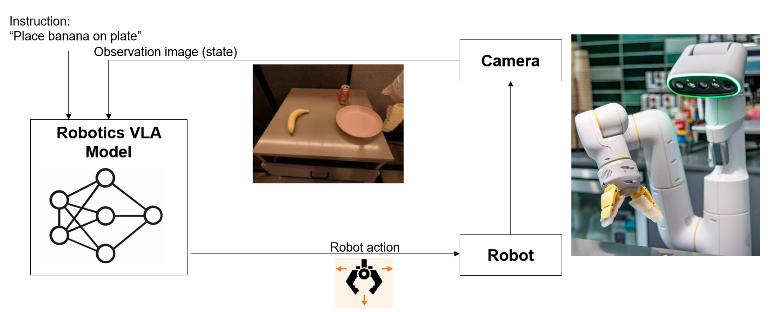
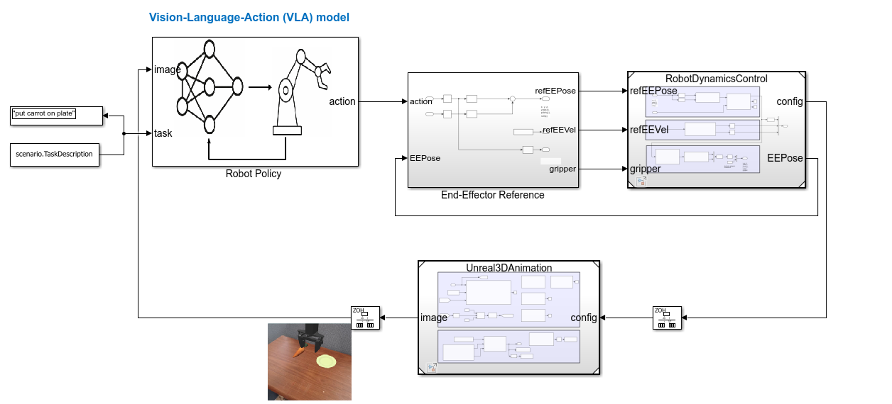
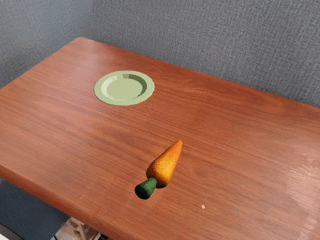
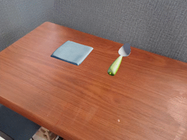
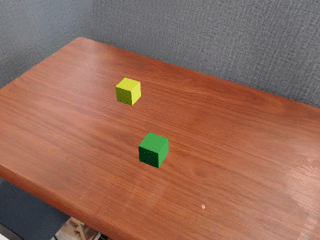
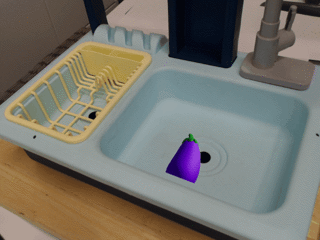
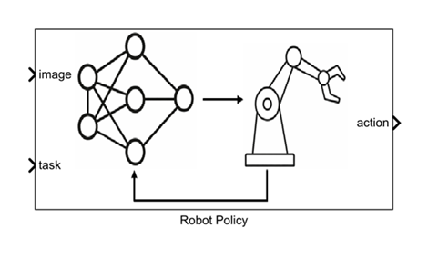
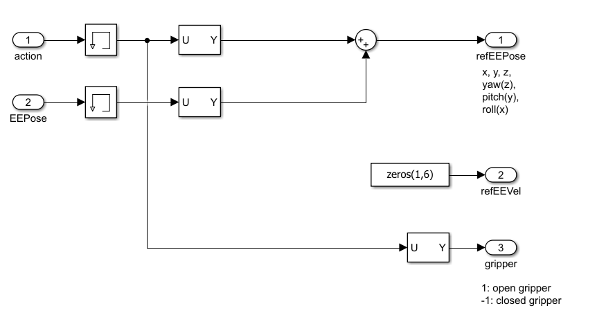
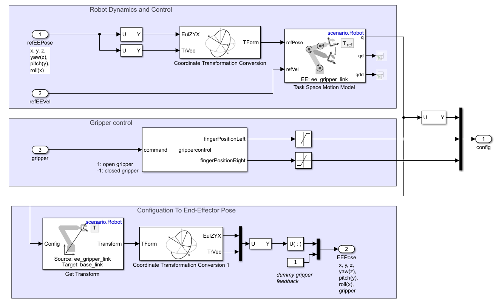
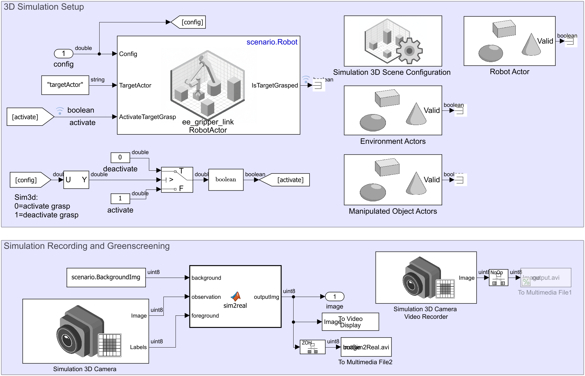

# Control Robot Manipulator Using Vision-Language-Action (VLA) Model in Simulink

[](https://www.mathworks.com/matlabcentral/fileexchange/184183-vision-language-action-vla-models-in-simulink)
[](https://matlab.mathworks.com/open/fileexchange/v1?id=184183)

Vision-Language-Action (VLA) models take a camera image and a natural language instruction (e.g., "put banana on plate") and predict robot actions directly, without task-specific motion planning. This makes them a promising approach for general-purpose robot manipulation, where a single model can handle a variety of tasks described in natural language.

This project provides a general framework for integrating VLA models into Simulink and demonstrates it with concrete implementations for two open-source models: Octo [1] and RT1-X [2]. Both are pretrained on large-scale robot demonstration datasets such as Open X-Embodiment [2], have fewer than 100M parameters, and are small enough to run on a laptop CPU. The integration pattern is designed to be reusable: adding a new VLA model requires only a Python wrapper (see [Adapting the Example](#adapting-the-example)).



- [Overview](#overview)
- [Setup](#setup)
- [Getting Started](#getting-started)
- [Model Details](#model-details)
- [Adapting the Example](#adapting-the-example)
- [Verification and Validation](#verification-and-validation)
- [Discussion](#discussion)
- [Feedback](#feedback)
- [References](#references)
- [License](#license)
- [Community Support](#community-support)

## Overview

Simulated evaluation of VLA policies can closely match real-world results [3], so you can test and iterate without a physical robot. This example shows how to do that in Simulink.

A VLA model (Octo [1] or RT1-X [2]) takes a camera image and a text instruction and outputs end-effector actions. These are converted to reference poses and tracked by a robot dynamics controller inside a 3D Unreal Engine&reg; scene. The scene camera feeds the next image back to the model at each step.



Having the policy, controller, and scene integrated in a single Simulink&reg; model makes it straightforward to swap VLA models, run scenario sweeps programmatically, and apply [verification and validation](https://www.mathworks.com/solutions/verification-validation.html) tooling directly to the complete closed-loop system.

## Setup

### MathWorks Products (https://www.mathworks.com)

Requires MATLAB&reg; release R2025b or newer
- [Robotics System Toolbox&trade;](https://www.mathworks.com/products/robotics.html)
  - Task-space motion model, forward kinematics, and robot import (rigidBodyTree)
- [Simulink&reg; 3D Animation&trade;](https://www.mathworks.com/products/3d-animation.html)
  - Unreal Engine 3D scene, camera, and robot visualization
- [Computer Vision Toolbox&trade;](https://www.mathworks.com/products/computer-vision.html)
  - Image compositing for sim-to-real green-screening

### 3rd Party Products

- [Python&reg;](https://www.python.org/) 3.10
  - MATLAB-Python cosimulation runtime for VLA model inference
- [TensorFlow&trade;](https://www.tensorflow.org/) 2.15
  - RT1-X model loading and inference
- [JAX](https://github.com/google/jax) 0.4.23
  - Octo model inference backend
- [Flax](https://github.com/google/flax) 0.8.1
  - Neural network layers for Octo
- [Transformers](https://huggingface.co/docs/transformers) 4.38.2
  - Vision-language backbone used by Octo
- [TF-Agents](https://www.tensorflow.org/agents) 0.19.0
  - Policy and action utilities for RT1-X

All packages are installed automatically via `installPythonEnv`.

**1. Install dependencies (run once after cloning)**

In MATLAB&reg;, from the repo root:
```matlab
installPythonEnv                  % downloads Python 3.10 + packages
```

**2. Configure paths and Python environment**

```matlab
projectstartup
```

### Verify Setup

Verify the Python environment is set up correctly:

```matlab
runtests("testPythonEnv")
```

Verify MATLAB toolbox requirements are met.

```matlab
runtests("testRobotPolicy") % First run is slow due to model download.
runtests("testRobotDynamicsControl")
runtests("testUnreal3DAnimation")
```

## Getting Started

Run `projectstartup` at the beginning of each MATLAB&reg; session to configure paths and the Python environment:

```matlab
projectstartup
```

Open the Simulink model, then run different scenarios by setting a task description and simulating. The scenario class determines the scene layout (e.g., table or sink).

- Open the Simulink model for closed-loop control with VLA-based robot policy

```matlab
model = "VLAClosedLoopControl.slx";
open_system(model)
```

- Run simulation with carrot and plate scenario

```matlab
scenario = BridgeDataTable;
scenario.TaskDescription = "put carrot on plate";
sim(model,"StopTime","25")
```



- Run simulation with spoon and towel scenario

```matlab
scenario = BridgeDataTable;
scenario.TaskDescription = "put the spoon on the towel";
sim(model,"StopTime","30")
```



- Run simulation with block stacking scenario

```matlab
scenario = BridgeDataTable;
scenario.TaskDescription = "stack the green block on the yellow block";
sim(model,"StopTime","30")
```



- Run simulation with eggplant and basket scenario

```matlab
scenario = BridgeDataSink;
scenario.TaskDescription = "put eggplant into yellow basket";
sim(model,"StopTime","35")
```




When done, run `projectshutdown` to clean up:

```matlab
projectshutdown
```

## Model Details

`VLAClosedLoopControl.slx` is the top-level model, connecting four components in a closed loop: **Robot Policy** generates actions from camera images and text instructions, **End-Effector Reference** converts them into reference poses, **RobotDynamicsControl** tracks those poses and returns the current end-effector pose, and **Unreal3DAnimation** renders the 3D scene and feeds the camera image back to the policy.

**Robot Policy**



A [MATLAB System](https://www.mathworks.com/help/simulink/ug/system-design-in-simulink-using-system-objects.html) block (`robotpolicy.m`) that wraps pretrained VLA models through co-execution with Python. It accepts an RGB camera image and a text task description, and outputs a 7-element action vector: end-effector translation (x, y, z), rotation (yaw, pitch, roll), and gripper state. Inputs are passed to the selected model (Octo [1] or RT1-X [2]) via Python inference wrappers (`octoModel.py`, `rt1xModel.py`). See [Adapting the Example](#adapting-the-example) for details on the wrapper interface.

**End-Effector Reference**



The VLA model outputs a relative action (position and rotation deltas), not an absolute pose. `End-Effector Reference` adds the 6-DOF action delta (elements 1–6) to the current actual end-effector pose, fed back from RobotDynamicsControl, to produce the new target pose (`refEEPose`). Reference velocity (`refEEVel`) is zero. The gripper command (element 7, 1: open, -1: closed) is extracted on a separate path.

**RobotDynamicsControl**



A [Coordinate Transformation Conversion](https://www.mathworks.com/help/nav/ref/coordinatetransformationconversion.html) block first converts `refEEPose` from Euler angles to a homogeneous transform, which the [Task-Space Motion Model](https://www.mathworks.com/help/robotics/ug/task-space-motion-model.html) block uses to compute joint configurations, velocities, and accelerations through proportional-derivative Jacobian-transpose control. The `grippercontrol` block takes the binarized gripper command (1: open, -1: closed), scales it to joint-space targets, and runs a PD position control loop at the simulation frequency to drive the fingers. The [Get Transform](https://www.mathworks.com/help/robotics/ref/gettransformblock.html) block then computes forward kinematics from the joint configuration, and a second [Coordinate Transformation Conversion](https://www.mathworks.com/help/nav/ref/coordinatetransformationconversion.html) block converts the result back to a 6-element end-effector pose (position and orientation), which feeds back to `End-Effector Reference` for the next step.

**Unreal3DAnimation**



In the _3D Simulation Setup_ area, the [Simulation 3D Scene Configuration](https://www.mathworks.com/help/robotics/ref/simulation3dsceneconfiguration.html) block sets up an Unreal Engine environment, a [Simulation 3D Robot](https://www.mathworks.com/help/robotics/ref/simulation3drobot.html) block visualizes the manipulator and handles grasp activation, and [Simulation 3D Actor](https://www.mathworks.com/help/sl3d/simulation3dactor.html) blocks place objects in the scene. In the _Simulation Recording and Greenscreening_ area, a [Simulation 3D Camera](https://www.mathworks.com/help/sl3d/simulation3dcamera.html) captures images and segmentation labels; segmentation identifies robot and object pixels, compositing them onto a real-world background photograph to reduce the sim-to-real visual gap [3]. The camera image feeds back to the VLA model and is also recorded to video files.

## Adapting the Example

**New VLA Model**

To integrate a new VLA model such as [OpenVLA](https://github.com/openvla/openvla) or [GR00T](https://github.com/NVIDIA/Isaac-GR00T), create a Python wrapper in `vlapy/` that adapts the model's raw outputs to the interface expected by `robotpolicy.m`. The existing wrappers for Octo and RT1-X (adapted from SimplerEnv [3]) illustrate the key adaptations typically required:

- _Image resizing_: Each model expects a specific input resolution; resize the camera image accordingly (e.g., Octo expects 256×256).
- _Action denormalization_: Models output normalized actions that must be rescaled to physical units; the normalization scheme depends on the model and training dataset (e.g., Octo uses z-scored actions rescaled using dataset mean and standard deviation).
- _Action ensembling_: Some models predict a horizon of future actions per step rather than a single action. The wrapper aggregates these into a single action, for example using exponentially weighted averaging for temporal smoothness.
- _Gripper binarization_: Models typically output a continuous gripper value that the wrapper thresholds to {−1, 1} (−1: close, 1: open).
- _Temporal context_: Models that attend over a sequence of past frames need the wrapper to maintain an internal image buffer. Initialize the buffer in `reset()` and append each incoming frame in `step()` before running inference.
- _Rotation convention_: Check whether the model outputs rotation deltas in roll-pitch-yaw (RPY) or another convention; return them as-is since `robotpolicy.m` reorders to yaw-pitch-roll (YPR) to match the Simulink end-effector convention.

The wrapper must implement this interface:

```python
def reset(task_description: str) -> None:
    # Called once at the start of each episode. Initialize internal state
    # (image history, policy state, action ensembler) here.

def step(image: np.ndarray, task_description: str) -> tuple[dict, dict]:
    # image: uint8 array of shape (H, W, 3)
    # If task_description changed since the last call, reset internal state.
    # Returns (raw_action, action) where action contains:
    #   'world_vector': np.ndarray (3,)  # xyz translation delta [m]
    #   'rot_axangle':  np.ndarray (3,)  # axis-angle rotation delta [rad]
    #   'gripper':      float            # binarized to {-1, 1}
    # robotpolicy.m reads only these three keys; additional keys are ignored.
```

On the MATLAB side, add a case for the new model name in `setupImpl` and `stepImpl` in `robotpolicy.m`. The normalization bounds (for denormalization) and gripper sign convention depend on the dataset the model was trained on; check the model's documentation or dataset statistics.

**Different Scene**

Write a scenario class that implements the `Scenario` interface to extend the example to a different scene. `ScenarioTemplate.m` in `scenarios/` is a starting point. For example, SimplerEnv [3] also supports the Google Robot, which could be integrated following the same pattern.

**Different Robot or Controller**

The interface between `Robot Policy` and the physical robot is the output of `End-Effector Reference`: a reference end-effector pose (`refEEPose`, a 6-element `[x, y, z, yaw, pitch, roll]` Euler pose), a reference velocity (`refEEVel`), and a gripper command. Everything upstream of this interface is robot-agnostic. `RobotDynamicsControl` is the model to replace when switching robots, controllers, or simulation fidelity.

- _Different robot arm_: Create a `Scenario` subclass with the new URDF and updated joint limits, end-effector link name, and finger geometry; implement `setupRobotActor` to load the new robot into the 3D scene. The Task-Space Motion Model block works with any `rigidBodyTree` and requires no changes.
- _Real hardware_: Replace `RobotDynamicsControl` with a hardware driver. The reference end-effector pose from the policy becomes a Cartesian setpoint; convert it to joint targets via IK and send it to the robot controller. Use ROS Toolbox Publish and Subscribe blocks to send joint commands and receive joint state feedback. Compute forward kinematics from the joint states and feed the resulting end-effector pose back to close the loop.
- _Simscape&trade; Multibody&trade;_: Replace the Task-Space Motion Model with a Simscape&trade; Multibody&trade; robot model to add realistic contact dynamics, joint friction, and inertia.

**Different World Simulator**

To replace Unreal Engine with a different simulator, replace the blocks inside `Unreal3DAnimation`; the rest of the model is unchanged.

- _ROS-based simulator (Gazebo, NVIDIA Isaac Sim&reg;)_: Replace the `Simulation 3D` blocks with ROS Toolbox publishers and subscribers. Publish the joint configuration as a `sensor_msgs/JointState` message; subscribe to a `sensor_msgs/Image` topic for the camera feed. `Robot Policy` and `RobotDynamicsControl` are unchanged.
- _Real camera_: Remove `Unreal3DAnimation` entirely and wire a real camera image directly to `Robot Policy`. This also removes the need for green-screening, since the policy receives real-world images directly.

The green-screening step exists because VLA models trained on real-world images are sensitive to visual appearance: background texture and camera pose have the largest effect on policy performance, while lighting and minor distractors have little impact [3]. Replacing the simulated background with a real photograph closes most of the visual gap. Note that green-screening assumes a fixed camera and does not reproduce object shadows. If you replace Unreal Engine with a photorealistic renderer, or switch to a real camera, remove the green-screening step.

## Verification and Validation

Because the complete system is built in Simulink, the following [verification and validation](https://www.mathworks.com/solutions/verification-validation.html) workflows can be applied directly to it, though they are not implemented in this example:

- Use [Requirements Toolbox&trade;](https://www.mathworks.com/products/requirements-toolbox.html) to formally specify task requirements and trace them to tests; for example, "the system shall complete the task under all built-in scenario configurations" or "the robot shall not exceed joint velocity limits during any episode"
- Use [Simulink&reg; Test&trade;](https://www.mathworks.com/products/simulink-test.html) to run automated test cases that verify those requirements against logged signals; for example, assert the object is placed within 5 cm of the target, the gripper closes within 10 seconds, or joint velocities stay within limits throughout the episode
- Use [Simulink&reg; Coverage&trade;](https://www.mathworks.com/products/simulink-coverage.html) to measure how many scenario configurations and decision branches were exercised; for example, verify that both gripper open and close paths were taken, or that all object placement configurations were simulated
- Use [Simulink&reg; Fault Analyzer&trade;](https://www.mathworks.com/products/simulink-fault-analyzer.html) to inject faults such as a frozen camera frame, a corrupted policy input, or a gripper failure mid-grasp, and verify the system's response
- Use [code generation](https://www.mathworks.com/products/pytorch-litert-onnx-coder.html) and [hardware deployment](https://www.mathworks.com/matlabcentral/fileexchange/68644-matlab-coder-support-package-for-nvidia-jetson-and-nvidia-drive-platforms) to deploy policies validated in simulation to real robot hardware

## Discussion

VLA models are advancing rapidly. Newer models like [OpenVLA](https://github.com/openvla/openvla) (7B parameters) already outperform much larger closed models across a broad set of manipulation tasks, while supporting local inference via quantization and low-rank finetuning on consumer GPUs. Models like π₀ combine flow matching with a pretrained vision-language backbone to perform dexterous tasks such as laundry folding and table cleaning across multiple robot platforms. NVIDIA's [GR00T N1](https://github.com/NVIDIA/Isaac-GR00T) (3B parameters) targets humanoid robots specifically, combining a vision-language backbone with a diffusion transformer action head trained on robot demonstrations and human video data. Smaller models (under 1B parameters) are also emerging for efficient edge deployment.

Current VLA models generalize best within their training distribution: familiar tasks, robot embodiments, and visual environments. Performance degrades out of distribution, though targeted fine-tuning can close much of this gap: models like GR00T N1 can be adapted to new robot setups with a handful of demonstrations.

Evaluating in simulation introduces gaps: textures, lighting, and contact dynamics differ from real hardware, which can affect model predictions. In practice, however, policies that perform well in simulation tend to perform well in the real world [3], making simulation a scalable proxy for hardware evaluation.

## Feedback

Tried this example? We'd love your feedback!

Share your experience to help us prioritize what to improve next - takes less than 5 minutes.

Give feedback ➜ [Feedback on Vision Language Action Models in Simulink](https://www.surveymonkey.com/r/GCHTJXX)

## References

[1] Octo Model Team, et al. "Octo: An Open-Source Generalist Robot Policy." ArXiv:2405.12213 [cs.RO], May 2024. https://octo-models.github.io/

[2] Open X-Embodiment Collaboration, et al. "Open X-Embodiment: Robotic Learning Datasets and RT-X Models." ArXiv:2310.08864 [cs.RO], Oct. 2023. https://robotics-transformer-x.github.io/

[3] Li, Xuanlin, et al. "Evaluating Real-World Robot Manipulation Policies in Simulation." ArXiv:2405.05941 [cs.RO], May 2024. https://simpler-env.github.io/

## License

The license is available in the License.txt file in this GitHub repository.

## Community Support

[MATLAB&reg; Central&trade;](https://www.mathworks.com/matlabcentral)

Copyright 2026 The MathWorks, Inc.